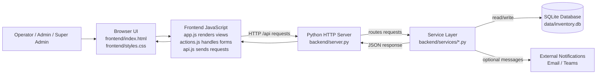
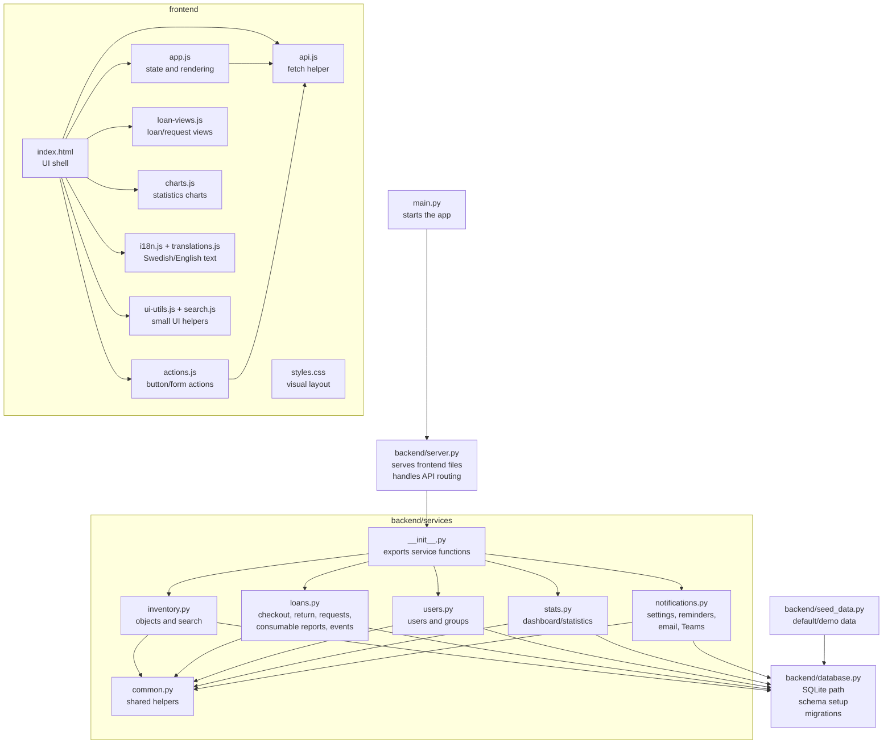
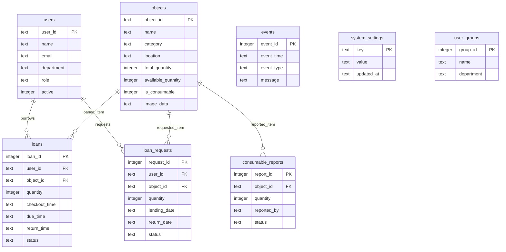

# Loan Inventory System Map

This map is meant for learning the project. Read it like a PLC overview drawing:
browser screens are the operator panel, JavaScript is the panel logic, Python
services are the control logic, and SQLite is the memory/database.

## Big Picture

## File Responsibilities

## API To Service Map

```mermaid
flowchart TB
    frontend[Frontend JS\napp.js + actions.js + api.js]
    server[backend/server.py]

    frontend --> server

    server --> get[GET APIs]
    server --> post[POST APIs]
    server --> put[PUT APIs]
    server --> del[DELETE APIs]

    get --> g1[/api/stats -> stats.dashboard_stats/]
    get --> g2[/api/statistics -> stats.statistics_data/]
    get --> g3[/api/objects -> inventory.list_objects/]
    get --> g4[/api/search -> inventory.search_objects/]
    get --> g5[/api/users -> users.list_users/]
    get --> g6[/api/groups -> users.list_groups/]
    get --> g7[/api/loans -> loans.list_active_loans/]
    get --> g8[/api/loan-requests -> loans.list_loan_requests/]
    get --> g9[/api/consumable-reports -> loans.list_consumable_reports/]
    get --> g10[/api/events -> loans.recent_events/]
    get --> g11[/api/system-settings -> notifications.get_system_settings/]

    post --> p1[/api/checkout -> loans.checkout/]
    post --> p2[/api/issue -> loans.issue_item/]
    post --> p3[/api/return -> loans.return_item/]
    post --> p4[/api/objects -> inventory.add_object/]
    post --> p5[/api/users -> users.add_user/]
    post --> p6[/api/groups -> users.create_group/]
    post --> p7[/api/loan-requests -> loans.create_loan_request/]
    post --> p8[/api/consumable-reports -> loans.create_consumable_report/]
    post --> p9[/api/reminders/send -> notifications.send_loan_reminders/]
    post --> p10[/api/loans/reminder -> notifications.send_loan_reminder/]
    post --> p11[/api/loan-requests/pickup-email -> loans.send_pickup_ready_email/]
    post --> p12[/api/teams/test -> notifications.send_teams_test_message/]
    post --> p13[/api/users/card -> users.set_user_card/]
    post --> p14[/api/users/borrow-override -> users.set_user_borrow_override/]

    put --> u1[/api/objects -> inventory.update_object/]
    put --> u2[/api/users -> users.update_user/]
    put --> u3[/api/groups -> users.update_group/]
    put --> u4[/api/loan-requests -> loans.update_loan_request_status/]
    put --> u5[/api/loan-requests/details -> loans.update_loan_request_details/]
    put --> u6[/api/consumable-reports -> loans.close_consumable_report/]
    put --> u7[/api/system-settings -> notifications.update_system_settings/]

    del --> d1[/api/objects -> inventory.delete_object/]
    del --> d2[/api/users -> users.remove_user/]
    del --> d3[/api/groups -> users.delete_group/]
    del --> d4[/api/loan-requests -> loans.delete_loan_request/]
```

## Database Tables

## Recommended Learning Route

1. Start at `main.py`.
2. Read `backend/server.py` until you understand how `/api/...` routes are chosen.
3. Pick one workflow, for example checkout.
4. Follow `frontend/js/actions.js` -> `/api/checkout` -> `backend/server.py` -> `backend/services/loans.py`.
5. Check which tables are touched in `backend/database.py`.
6. Repeat with return, object admin, user admin, and notifications.

